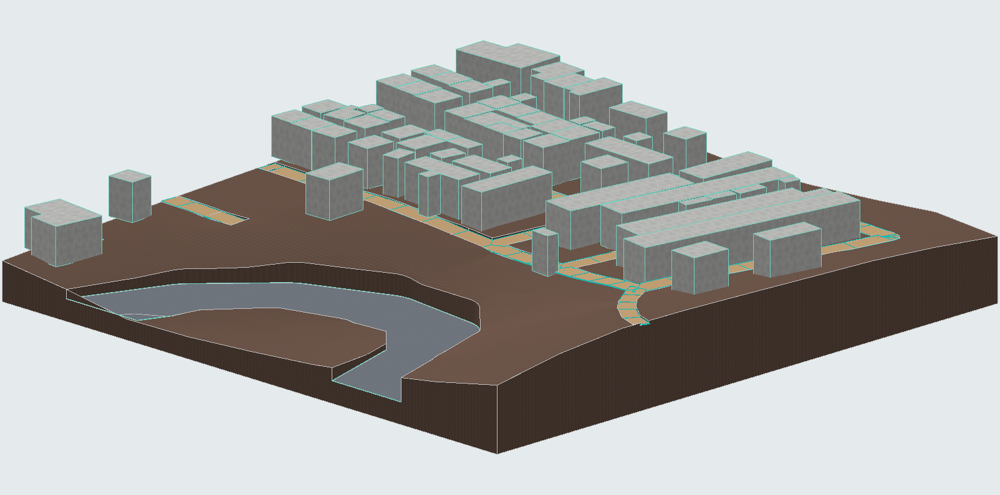
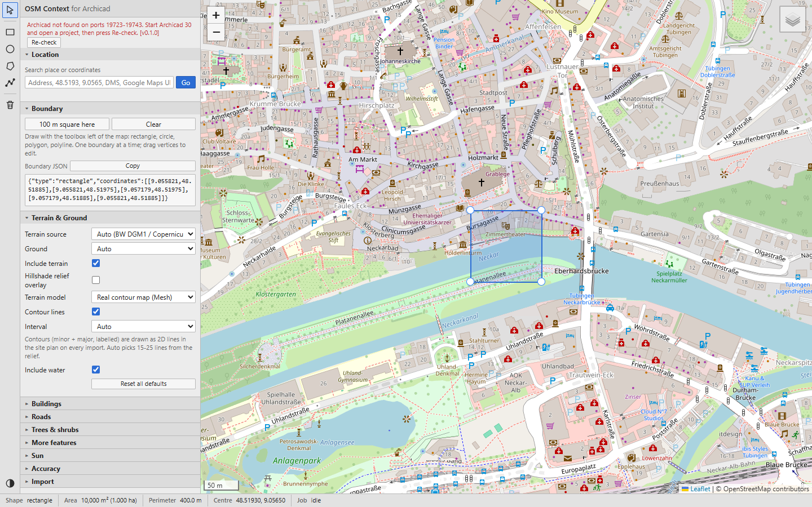
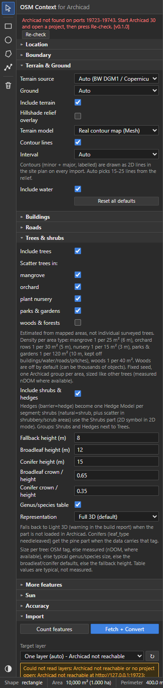
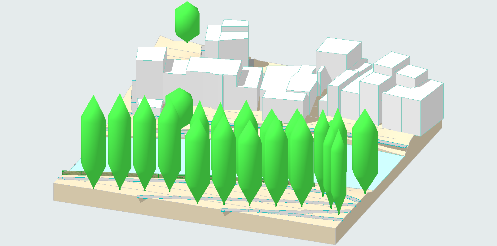
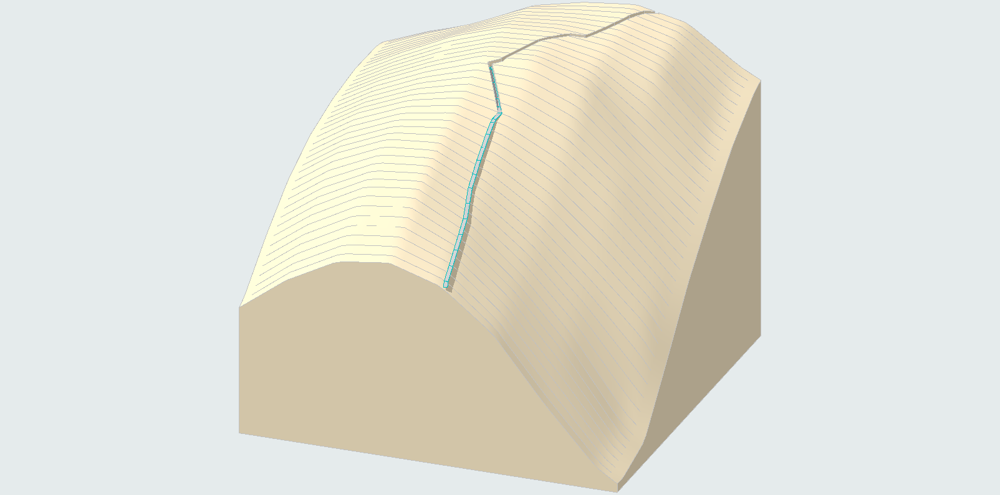
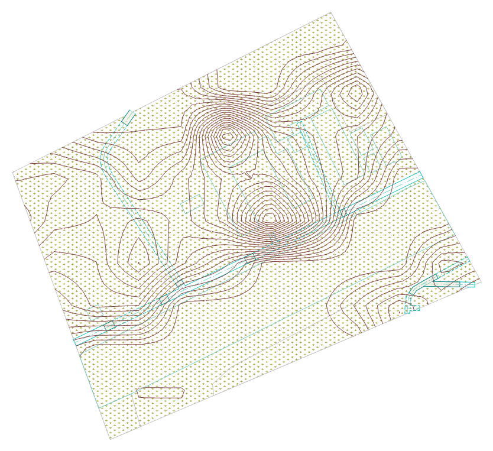

# OSM Context for Archicad

Pull a site's surroundings — terrain, buildings, roads, water, trees — from open data straight into an Archicad project, built with **native Archicad tools** (Mesh, Slab, Beam, library objects), not imported meshes or DWG lines.



> **Status: v0.1.0, early release.** It works end to end on Windows with Archicad 30. Some recent features (the stepped contour model, plan colours, layered terrain sources) have only been tested offline so far. **Save or back up your Archicad project before importing.**

## Contents

- [What it does](#what-it-does)
- [Features](#features)
- [Gallery](#gallery)
- [Installation](#installation)
- [Tutorial: your first site](#tutorial-your-first-site)
- [Settings reference](#settings-reference)
- [Troubleshooting](#troubleshooting)
- [For developers](#for-developers)
- [Data credits](#data-credits)
- [License](#license)

## What it does

Draw a boundary on a map, then **Fetch → Convert → Import**:

| Site element | Source | Archicad tool |
|---|---|---|
| Terrain | Best available elevation model for the site (national LiDAR where available, global fallback) | Mesh, or a stepped contour model made of Slabs |
| Contour lines | Derived from the terrain | 2D polylines with height labels on the floor plan |
| Buildings | OpenStreetMap, gaps filled from Overture Maps | Slab masses, with roofs and building parts as an option |
| Roads, railways | OpenStreetMap | Beams |
| Water | OpenStreetMap | Slabs |
| Trees, shrubs, hedges | OpenStreetMap, plus area-based scatter for parks, orchards and forests | Library objects |
| Walls, fences, piers, power towers and poles | OpenStreetMap (under *More features*) | Native elements |

Every imported element gets a classification, `OSM ID` / `Source` properties and an Archicad group, so a **re-import replaces the previous one cleanly**. The import also sets the project location and the sun position for the date and time you choose.

## Features

**Map and boundary**
- Search by address, decimal coordinates, degrees-minutes-seconds or a pasted Google Maps link
- Boundary as a rectangle, circle, polygon, or a polyline corridor (for roads and rivers) with an adjustable half-width
- Live area, perimeter and centre in the status bar; copy or paste the boundary as JSON
- Feature count and download estimate before fetching
- Light and dark mode

**Terrain**
- 15+ elevation sources:
  - national LiDAR: Netherlands 0.5 m, France 0.5 m, UK 1 m, Norway 1 m, USA 3DEP, Baden-Württemberg 1 m, Indonesia DEMNAS
  - polar: ArcticDEM, REMA
  - global: Mapterhorn, GEDTM30, FABDEM, Copernicus GLO-30
  - your own GeoTIFF
- *Auto* and *Layered* modes pick the most detailed source available and blend the edges into a global fallback
- Bare-earth approximation removes buildings and trees from surface models
- Hillshade relief preview on the map
- Two terrain models: a smooth **Mesh**, or a **stepped contour model** of flat Slab terraces, like a physical site model
- Labelled 2D **contour lines** on the floor plan (minor and major), with an automatic or fixed interval from 0.25 to 10 m
- Land-cover meshes draped on the terrain (beach, sand, wetland, mangrove)

**Buildings**
- OpenStreetMap footprints with heights from `height` / `building:levels` tags, or your default floor height and level count
- Gaps filled from **Overture Maps** (Google Open Buildings, Microsoft, Esri), marked as estimated
- Optional building parts and roof shapes

**Roads and infrastructure**
- Roads as Beams with widths from the road type, draped on the terrain, with bridges kept level over water
- Railways and platforms, walls and fences, piers and bridge decks, power towers and poles

**Vegetation**
- Mapped trees as library objects, randomly rotated, with sizes from OSM tags, measured canopy heights (where available) or a genus/species table
- Tree scatter in parks, orchards, nurseries, mangroves and forests, plus shrubs and hedges
- Full 3D or light representation; custom library part names

**Archicad integration**
- Native tools only: Mesh, Slab, Beam and library objects. Gaps where Archicad has no fitting tool are flagged in the build report.
- Classifications, `OSM ID` / `Source` properties and groups per element type; a re-import replaces the previous import
- Everything on one story; optional single target layer (works with office templates that don't allow new layers)
- Plan graphics: water, ground, building and road fills, and road beams shown as outlines on their home story
- Project location (geolocation) and sun position for a chosen date and time
- Build report with counts, warnings and a check that every element landed where expected

**Large sites and performance**
- Super-light preset for big areas: 2D trees, coarser terrain, no minor paths
- Downloads run in parallel and are cached, so repeat runs for the same site are instant
- Data credits for every source used are written into the project automatically

**Ways to run it**
- Standalone Windows app (`OSM Context.exe`), its own window, no Python needed
- From source with Python
- Launched from inside Archicad via the Python Palette

## Gallery

| | |
|---|---|
|  |  |
| *The map interface: search a place, draw a boundary, set options.* | *Side panel (dark mode): terrain, trees and import settings.* |
|  |  |
| *Riverside town with trees, water and rail.* | *Extreme terrain (Everest) still imports as one Mesh.* |
|  | |
| *Floor plan: contour lines and roads drawn in 2D.* | |

## Installation

### 1. Requirements

- Windows 10 / 11, 64-bit
- **Archicad 30**
- An internet connection (map tiles and data downloads)

### 2. Install the Tapir add-on in Archicad

OSM Context talks to Archicad through [Tapir](https://github.com/ENZYME-APD/tapir-archicad-automation), a free add-on.

1. Download the Tapir release for Archicad 30 from the [Tapir releases page](https://github.com/ENZYME-APD/tapir-archicad-automation/releases).
2. In Archicad: **Options → Add-On Manager**, add the downloaded add-on, and restart Archicad.

### 3. Install OSM Context

**Option A: Windows app (no Python needed).**
Unzip the release folder anywhere, for example `C:\Tools\OSM Context`, and double-click `OSM Context.exe`.
If no ready-made zip is published yet for your version, build it yourself (see [For developers](#for-developers)).
The exe isn't code-signed, so Windows SmartScreen may warn about an unknown publisher: click **More info → Run anyway**.

**Option B: run from source.**
You need [Python 3.13](https://www.python.org/downloads/) and [Git](https://git-scm.com/).

```powershell
git clone https://github.com/zidaneasyad/Archicad-OSM-Extractor.git
cd Archicad-OSM-Extractor
python -m venv .venv
.venv\Scripts\python.exe -m pip install -r requirements.txt
.venv\Scripts\python.exe app_main.py
```

`app_main.py` opens the app in its own window. Alternatively, double-click `Start OSM Context.bat`, which opens it in your browser at `http://127.0.0.1:8765`.

**Optional: start it from inside Archicad.**
Archicad → **Window → Palettes → Python Palette** → add (browse to) the `palette` folder → click **OSM Context**.

## Tutorial: your first site

1. **Open Archicad 30 and your project.** If you're experimenting, use a new empty project.
2. **Start OSM Context.** The top of the side panel shows whether Archicad and Tapir were found. If not, start Archicad, open a project and press **Re-check**.
3. **Find your site.** Under **Location**, type an address, coordinates (`48.5193, 9.0565`) or a Google Maps link, then press **Go**.
4. **Draw a boundary.** Use the toolbox on the left edge of the map: rectangle, circle, polygon, or a polyline corridor along a road or river. Or press **100 m square here** for a quick test. Drag the corners to adjust. The status bar shows the area.
   > Start small. A 100–150 m square imports in well under a minute. Large areas can take several minutes to fetch.
5. **Choose what to include.** Open the panels — **Terrain & Ground**, **Buildings**, **Roads**, **Trees & shrubs**, **More features**, **Sun** — and tick what you need. The defaults are a good start.
6. **Check the size first (optional).** In **Import**, press **Count features** to see how many buildings, roads, trees and water areas you'll get. For large areas the app suggests the **super-light preset** (2D trees, coarser terrain, fewer small roads), which keeps the import fast.
7. **Fetch + Convert.** This downloads the map, building and elevation data and turns it into a local site model. The **Convert report** lists counts, defaults it used and warnings. Downloaded data is cached, so a second run for the same area is instant.
8. **Import to Archicad.** Pick the **Target layer** (by default everything goes on one layer, which also works with office templates that don't allow new layers), then press **Import to Archicad**.
9. **Look at the result.** In the 3D window you'll see terrain, buildings, roads, water and trees. On the floor plan you'll find the contour lines and labels. Elements are grouped by type, so you can select, hide or delete them as a group.
10. **Changed something?** Adjust the settings and import again: the previous import is replaced, not duplicated.

## Settings reference

**Terrain & Ground**
- **Terrain source**:
  - *Auto*: the best local source, falling back to Copernicus GLO-30.
  - *Layered stack*: national LiDAR first, then Mapterhorn, then GLO-30.
  - A specific dataset: Netherlands AHN 0.5 m, France IGN 0.5 m, UK EA 1 m, Norway 1 m, USA 3DEP, Baden-Württemberg 1 m, Indonesia DEMNAS ~8 m, ArcticDEM, REMA, GEDTM30, FABDEM, Copernicus.
  - Your own DEM GeoTIFF file.
- **Ground**:
  - *Auto*.
  - *As-is*.
  - *Bare-earth approximation*: removes buildings and trees from surface models.
- **Terrain model**:
  - *Real contour map (Mesh)*: a smooth terrain.
  - *Stepped contour model (Terrace Slabs)*: flat terraces like a physical contour model.
- **Contour lines** and **Interval**: 2D contours on the plan, *Auto* or 0.25–10 m.
- **Hillshade relief overlay** shows the terrain on the map before you import.

**Buildings**: floor height, default number of levels when OSM has none, and filling missing buildings from Overture Maps (useful in villages and the Global South).

**Trees & shrubs**:
- Individual mapped trees, plus optional scatter in parks, orchards, nurseries, mangroves and forests.
- Shrubs and hedges.
- Heights and crown sizes.
- 3D or light representation, and a custom library part name.

**More features**: railways and platforms, walls and fences, building parts and roofs, ground surfaces, piers and bridge decks, power towers and poles.

**Sun**: the date and local time, applied to the project's sun position.

**Accuracy**: what the data can and can't tell you for this site. This is site context, not a survey.

## Troubleshooting

| Problem | What to do |
|---|---|
| "Archicad not found on ports 19723–19743" | Start Archicad 30, open a project, check that Tapir is loaded (Add-On Manager), then press **Re-check**. |
| Windows "protected your PC" warning | The exe is unsigned: click **More info → Run anyway**. |
| Fetch takes a long time | Overture buildings and large elevation tiles take a while on the first fetch. Try a smaller boundary or the super-light preset. Repeat fetches use the cache. |
| Trees show as simple shapes or a warning about library parts | The tree library part isn't loaded in your project. The app falls back to a lighter version and notes it in the build report. |
| Wrong or flat terrain | Try another **Terrain source**. Global 30 m data is coarse; use a national dataset where available. |
| Something looks wrong after import | Delete the imported OSM groups (or re-import with other settings), then report an issue with the build report from the app. |

## For developers

Project layout:
- `osmctx/` holds the pipeline:
  - `fetch.py`, `dem_sources.py`, `overture.py`: download data
  - `convert.py`: build the local site model
  - `build_plan.py`: turn it into Archicad payloads
  - `build_ac.py`: import through Tapir
- `server.py` is the FastAPI backend.
- `ui/` is the Leaflet map interface.
- `palette/` is the Archicad Python Palette launcher.
- `packaging/` builds the Windows app.

Run the tests (offline, with a fake Archicad; no Archicad instance needed):

```powershell
.venv\Scripts\python.exe -m pytest -q
```

Build the Windows app:

```powershell
.venv\Scripts\python.exe packaging\build.py
```

This produces `dist\OSM Context\OSM Context.exe` plus a zip. See `packaging/README.txt` for end-user instructions.

The import can also run from the command line: `python -m osmctx.build_ac out/site.json`, with `--contour-type mesh` or `--contour-type stepped`.

## Data credits

Keep these credits on anything you publish that uses imported data. The importer also writes the credits for the sources it used into the project.

- Map data © [OpenStreetMap](https://www.openstreetmap.org/copyright) contributors, ODbL
- Buildings: [Overture Maps Foundation](https://overturemaps.org) (ODbL parts), including Google Open Buildings, Microsoft ML Building Footprints and Esri Community Maps (CC BY 4.0)
- Elevation, depending on the site and the source chosen:
  - Copernicus GLO-30 DEM © DLR / ESA
  - LGL Baden-Württemberg, Datenlizenz Deutschland – Namensnennung – Version 2.0
  - USGS 3DEP (public domain), PDOK AHN (CC0 1.0), IGN France (Licence Ouverte 2.0), Environment Agency / NRW (OGL v3.0), Kartverket (CC BY 4.0), BIG Indonesia DEMNAS, PGC ArcticDEM / REMA (CC BY 4.0), Mapterhorn, OpenGeoHub GEDTM30 (CC BY 4.0)
  - FABDEM is **CC BY-NC-SA 4.0 (non-commercial)**: check its licence before commercial use

This is site context, not a survey: use a topographic survey for design levels.

## License

[MIT](LICENSE) © 2026 ENZYME APD
